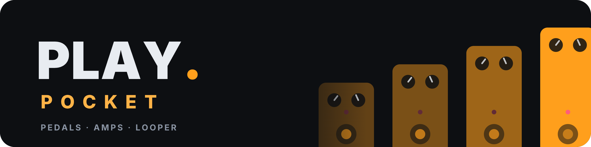
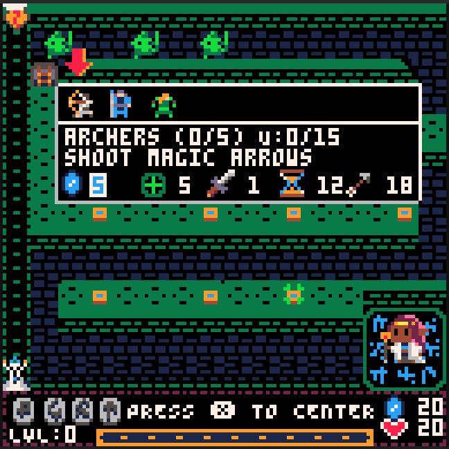

# PLAY.Pocket

A pocket guitar rig in one HTML file: plug a guitar into an audio interface or a USB guitar cable, and play it through pedals, amps and cabs laid out on a board, over your own backing tracks and loops, in the browser. The sister app of [TRACK.Pocket](https://github.com/utopick/track-pocket), [TUNE.Pocket](https://github.com/utopick/tune-pocket) and [SING.Pocket](https://github.com/utopick/sing-pocket): no dependencies, no network requests.

**Status: 1.0.0, the first release.** It has 16 pedals, 4 amps and 4 cabs (where each comes from: [docs/UNITS.md](docs/UNITS.md)), a board to order them, a live play view of one unit, a synthesized test riff, a looper (TUNE.Pocket's, lined up with the measured latency, with edit tools, effects and its loops kept on the device), a synth, a voice changer, backing tracks from your device, a mixer with effect pads, a latency test and the usual Files tab (named pedal chains, board export and import, themes, options, help in English and Spanish). It installs as a web app (PWA) and works offline.

**Open it:** [utopick.github.io/play-pocket](https://utopick.github.io/play-pocket/) · **Install it:** it is a web app (PWA): on Android, Chrome ▸ **Install app**; on iPhone, Safari ▸ Share ▸ **Add to Home Screen**; on a computer, the install icon in the address bar. Once installed it opens like an app and works offline.

I've been adding features and tweaking a lot, so they come out not fully tested, and there could be bugs. Leave me an issue and I'll fix it.

There is a help wiki inside (también en español), with small interactive demos you can touch and hear: a DRIVE that squashes the wave, a sound built from waves and a loop recorded in time.

## Why did I release these apps? 

Because GitHub allows me to host them in a GitHub site if I make them public, and I don't want to host them myself. 

Also because my friends told me that they are useful and some of you may want a free, ad-less gadget to pass the time.

## Ads and cookies

Yeah, no.

No ads, no cookies, no nothing. This is free and clean. No hidden stealers, no weird intentions.

Why is it free? Because not everything should be a product.

## AI use

I'm a programmer and I have been coding for a living for over two decades, but life has given me too little free time that I want to spend offline and outside, making music and art. So I used a lot of AI to build this in a quick and easy way.

I'm not going to take credit for the code, even though I started this app from my own older code. I built it with the help of an AI coding assistant (Claude, by Anthropic), which wrote and reworked much of the code following my designs and notes.

The app itself uses no AI: everything runs on your device, and nothing you play, sing or record is sent to any AI service or anywhere else for that matter. If that isn't the case just shame me publicly and I'll fix it.

I did waste a lot of tokens by making it code it in a non-minified way, so if the bubble bursts and we go back to the basics it could be maintainable. 

If you want to try something made by me by hand (95%, I did use an early model to find some bugs but solved them by hand) in which I made the code, assets, music and all, check out Nanaya, my Pico-8 tower defense game: https://www.lexaloffle.com/bbs/?tid=153336

## How to run it

Serve the folder from `localhost` or HTTPS (the browser only gives the microphone to secure pages), for example with the workspace's `dev-server.js`, and open it in Chrome or Firefox on a computer, or Firefox on Android. Use headphones or the interface's output: with a phone's own mic and speaker the sound feeds back.

## The basics

- **LIVE PLAY** (the pedal icon at the top): **PEDALS, AMPS, CABS** (the bottom bar) show one unit at a time, full screen; **◁ ▷** or a swipe changes it. Drag a knob up or down; the switch turns the unit on. The metal **TEST** button plays a test riff through the rig, and the waveform shows what goes into the unit and what comes out.
- **BOARD** (the squares icon at the top): the signal enters at the top right and snakes square by square to the speaker at the bottom right. Tap an empty square to add a unit, tap a unit to turn it on or off, press and hold it (or double tap) to open it, drag it to move it.
- **LOOPER** (the loop icon, TUNE.Pocket's): tempo, click, loop length (1, 2, 4 or 8 bars), recording delay and auto quantize; tap an empty pad to count in and record your board, tap a loop to play or stop it on the bar. EDIT: volume, overdub, reverse, normalize, nudge, quantize, crop, clear. FX: repeat, reverse, octave. UNDO. The loops are kept on the device.
- **SYNTH** (the keyboard icon): sixteen instruments made by the app (leads, synthwave, lo-fi, bass, pads, keys: subtractive, FM and organ synthesis), MY SOUND (chain up to six waves of your own) and four SAMPLES (record the input, load a file or take a loop, with a LOOP button), with the wave drawn at the top, played from a MIDI controller (notes, velocity, sustain pedal, pitch bend, mod wheel) or the keys on the screen, with filter and envelope knobs, through the pedal board by default.
- **VOICE** (the face icon): the microphone through a voice changer (pitch shifter plus robot, megaphone, alien, choir and echo). Use headphones.
- **MIXER** (the faders icon, or the speaker square) has a knob, a mute and a meter for each source (guitar, test riff, synth, voice, tracks, loops, click, master) and a lower button that swaps it for **FX PADS** on the whole mix (lo-fi, tape, radio, stutter, reverb... to latch or hold).
- **TRACKS** (the note icon): add audio files from the device (kept in the browser, never uploaded) and play along.
- **RECORD** (or the microphone icon at the top) starts listening. The thin bar under the top icons is the input level.
- **The disk** (top right) opens Files: **FILES** (export, import, reset the board), **THEME**, **OPTIONS** and **HELP**.
- **OPTIONS** has the stats the browser reports, the **LATENCY TEST** (a ball bounces; pick a string on each click; or plug a cable from the output into the input and let it measure itself), the input, channel, gain and output, and the engine switches (sample rate, buffer, oversampling, raw input).

### Themes

Six looks, from the disk ▸ **THEME**: Dark, Light, Terminal, Dungeon synth, DMG and Demoscene. All the Pocket apps share them.

### Your data

The board, the knobs, the mixer and the options are stored in your browser (`localStorage`); the loops, the backing tracks and the samples in its database (`IndexedDB`). None of it is uploaded anywhere. Clearing browser storage removes them, so export the board from **FILES** first.

## Install it as an app (PWA)

PLAY.Pocket is a progressive web app (PWA): the hosted page can be installed on the home screen or desktop, opens in its own window without browser bars, and keeps working with no connection. There is no store and no download. The first visit has to be online; after that it starts offline.

### iPhone and iPad (iOS)

1. Open [utopick.github.io/play-pocket](https://utopick.github.io/play-pocket/) in **Safari** (other iOS browsers cannot install web apps from the share menu).
2. Tap **Share**, then **Add to Home Screen**, then **Add**.
3. Open it from the new icon. The microphone asks for permission the first time you use it.

Notes: Safari on iOS has no Web MIDI, so MIDI keyboards and pads do not work there. On iOS, Safari deletes the data of websites you have not used for 7 days, but an app added to the Home Screen is exempt from that rule: so install it, rather than keeping it in a Safari tab. Even so, export what you want to keep (iOS can still free storage when the phone is nearly full).

### Android

1. Open the page in **Chrome** (Edge, Brave and Samsung Internet work too).
2. Choose menu ⋮ ▸ **Install app** (or **Add to Home Screen**), or accept the install banner if it shows.
3. Open it from the icon. Allow the microphone when asked; if you refused it, tap the lock icon in the address bar of a normal tab (or **Settings ▸ Apps ▸ PLAY.Pocket ▸ Permissions**).

MIDI keyboards and pads over USB or Bluetooth work in Chrome (Web MIDI).

### Desktop (Windows, macOS, Linux, ChromeOS)

1. Open the page in **Chrome** or **Edge** and click the install icon at the right end of the address bar (or menu ▸ **Install PLAY.Pocket**).
2. It opens in its own window and can be pinned to the taskbar or dock.
3. Firefox and Safari on desktop can use the page in a tab, but do not install it; Firefox also has Web MIDI, Safari does not.

### Good to know

- **Updates:** whenever it is online the app fetches the newest version; close and reopen it to run it.
- **Your data** lives in the browser's storage for this site (the installed app and a tab of the same browser share it). Export the board and save the loops and tracks you want to keep before clearing browser data or switching device.

### Why is there a service worker (`sw.js`)?

Browsers only allow an app to work offline, and only offer to install it, if the site registers a **service worker**: a small script that sits between the page and the network. This one does a single job: on the first visit it saves the app's own files (`index.html`, the manifest and the icons) in the browser's cache, and afterwards it answers from that cache when you are offline. It asks the network first, so when you are online you always get the latest version. It cannot be part of `index.html`, because browsers load it as a separate file, and it never touches your songs, recordings, microphone or MIDI, and sends nothing anywhere.

## Browsers and systems: what works where

The Pocket apps that listen (TUNE's tuner and looper, SING, PLAY) depend a lot on the browser and the system, more than on the phone or computer. Hearing yourself through the app while you play is the hard case: it needs the sound to go out and come back in quickly. These are round trips we measured in November 2026, with a cable from the audio interface's output back into its input, using [LAB.Pocket](https://utopick.github.io/test/latency-lab/) and PLAY.Pocket's latency test:

| System | Browser | Round trip | Play through it? |
|---|---|---|---|
| Mac + Focusrite Scarlett Solo | Chrome | 18–20 ms | yes |
| Mac + Focusrite Scarlett Solo | Firefox | 18 ms | yes (mind the output, below) |
| Mac + Focusrite Scarlett Solo | Safari 26 | about 110 ms | no |
| Android 16 phone, USB guitar cable or its mic | Firefox | 30–33 ms | yes |
| Android 16 phone | Chrome, and every browser built on it | 110–340 ms | no |
| iPad (2019), iPadOS 18 | Safari, and every other iOS browser | 77–127 ms, built-in mic only | no |

Under about 30 ms it feels like an amp; up to 60 ms it is playable with a little lag; beyond that it is an echo. Tuning, recording and playback work everywhere: only live monitoring needs the fast ones.

### The nitpicks

- **Use one interface for input and output.** Two devices run on two clocks: the Scarlett in and the Mac's headphone jack out gave 52–55 ms instead of 19.
- **Match the sample rate.** If the app runs at 44.1 kHz and the interface at 48 kHz, the browser converts between them, which costs about 6 ms. Chrome tells the app the input's rate, so it matches it by itself; Firefox does not, so set the rate by hand there (48000 Hz for most interfaces).
- **Firefox and the output choice.** Chrome can send the sound straight to any output. Firefox can only do it through its media player, which buffers for smooth music: 72 ms instead of 18. In Firefox, leave the app's output on system default and choose the output in the system's sound settings.
- **Raw input.** The browser's echo cancelling, noise suppression and automatic gain are made for calls: they add delay and change your tone. The apps turn them off.
- **The buffer setting barely matters.** The browser's "interactive" mode is already its smallest buffer; asking for 5 ms gained 1–2 ms on a computer and nothing on Android.
- **Distortion oversampling** (smoother drive) costs 3 ms at 2× and 4 ms at 4×.
- **Android:** Chrome's microphone path is slow, and it is the same in Edge, Brave, Samsung Internet and in-app browsers. Firefox uses Android's fast audio path: use Firefox to play through the app.
- **iPhone and iPad:** every browser there is Safari underneath. Once a page opens the microphone it records the built-in mic even when a USB interface is chosen ([WebKit bug 211192](https://bugs.webkit.org/show_bug.cgi?id=211192)), moves the sound to the iPad's own output, and lags more and more after the iPad sleeps. Pages that only play sound (TRACK) do play through an interface. Native apps like AUM use the interface fine: it is the browser, not the iPad.
- **Your hands count too.** Played by hand, the same test reads about 20 ms more than with a cable: most people play slightly after a click they hear.
- **The apps stop listening in the background**, so they never come back with a stuck microphone after the screen locks.

## Files

- `index.html`: the complete app (markup, styles, audio engine, help)
- `manifest.webmanifest`, `sw.js`, `icons/`: what makes it installable and offline (`docs/PWA.md`)
- `docs/UNITS.md`: where every pedal, amp and cab comes from and how it is built
- `docs/MAINTAINING.md`: notes for whoever maintains it. `tests/e2e.py`: automated checks (Selenium)
- `LICENSE`: license terms

## License

PLAY.Pocket is released under the MIT License (see `LICENSE`).

AI assisted coding uses the uncredited work of a lot of coders through the years (me included) so anything I make that's not for work its as free as possible.

Have fun.

### Third-party code

The banner, app icons and favicons are lettered in [Inter](https://rsms.me/inter/) (SIL Open Font License 1.1), converted to shapes, so no font file is included. The app itself has no third-party code.

## The readmes

Yeah. They are all similar. I copied and pasted. No one ever reads them all. Kilroy was here.

Anyway, listen to me: You matter. A lot. I don't know you stranger, but you have my admiration and love. Keep making art.